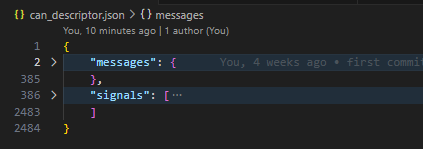
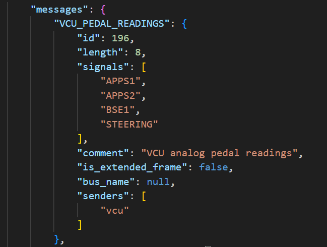
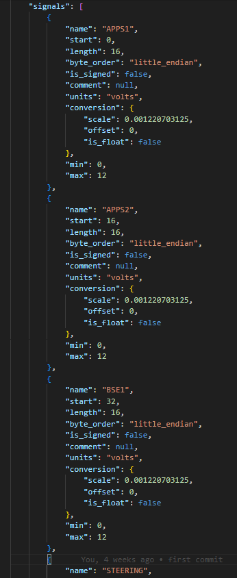

# Kennesaw Motorsports DBC generator repo

this repository contains all of the the files which define the CAN bus traffic on both the IC and EV platform.

contact @mathbrook with any issues

```dbc-files``` contains the EV motor controller DBC file, the IC ECU DBC file, and the EV BMS DBC file, if you add to this update the default.nix file to reflect it.

```can_descriptor.json``` currently defines all of the custom messages on the EV platform. "custom" messages are any that we own the definition of.

### Adding messages

If you want to add a CAN message, open ```can_descriptor.json``` with your text editor of choice. VSCode has nice support for .json files with highlighting and error catching.

```can_descriptor.json``` consists of two sections, the "messages" section and the "signals" section.



to add your message, you can start by adding its defintion to "messages".

your message should be formmated like so:



then add each signal defintion following the others as an example



once you've made your changes, it's time to run the dbc generator

*I would not recommend trying to add messages if you do not have a good understand of CAN messages and their structure. If you do want to try adding messages, make sure you are making changes on a branch and make a pull request before merging your changes into main*

## Running the DBC generator

if you have not already, install python

then, in the root of this repo, run

```python
python -m pip install virtualenv
virtualenv venv
.\venv\Scripts\activate
pip install -r "requirements.txt"
```

if that went smoothly, you can now run the generator!

the generator takes in multiple arguments: here is an example command and likely what you want to run:

```python .\json_to_dbc.py .\can_descriptor.json .\dbc-files\ksu-ev Orion RMS_PM```

the first argument, ```.\can_descriptor.json``` is the input json file which gets translated to a cantools Database object in the script. the second argument ```.\dbc-files\ksu-ev``` is the output path for the generated dbc file. the last two args (and more can be added) are keywords for additional DBC files to include in the final output dbc

## Vehicles: one DBC per car configuration

`gen_tool/vehicles.json` describes the cars the DBCs are built for:

- `buses`: the physical CAN buses (name, bitrate);
- `networks`: which bus each logical network a message names (`bus_name`: `daq`,
  `inverter`, `accumulator`) is on. Today all are on one bus, `KSX`; splitting the car
  onto more buses is an edit here;
- `inverter_kinds`: how a kind's messages come in: a vendor DBC as is (Cascadia
  PM100DX with the EMRAX), DTI's HV500 DBC instantiated per node (extended IDs,
  `packet << 8 | node`), or the AMK KW26 racing kit's telegrams
  (`gen_tool/inverters/amk_kw26.json`, from AMK's manual PDK_205481, base address +
  node);
- `vehicles`: each car's inverters by position (`rear`, `fl`, `fr`, `rl`, `rr`), kind and
  node. Names match the drivetrain variants simulated in python-data-analysis
  (`kmslap/car/drivetrain.py`): `rwd_emrax` (the car as it is, the default),
  `awd_emrax_dti`, `awd_emrax_amk`, `4wd_dti`, `4wd_amk`.

`python3 gen_tool/vehicles.py --out dbc-output` (or `nix build`) writes `car.dbc`, the
default vehicle's (what the firmware pins), and `vehicles/car_<name>.dbc` for each.
Inverter messages are named after their position, `inv_<position>_<message>`
(`inv_fl_setpoints_1`, `inv_rr_erpm_duty_voltage`), sent by `inv_<position>`.

Each release also carries `can_lib_<name>.tar.gz` and `ksu_can_<name>.dbc` for every
vehicle. The library is named `can_lib` with the same `car.h` API as the default one,
so firmware chooses a vehicle by which tarball it depends on.

## Tests

```sh
nix develop -c pytest -q gen_tool
```

`gen_tool/tests/` builds every vehicle and checks:
- that the default vehicle is the single-DBC build;
- that no two messages share an ID on a bus;
- that every DBC reloads with cantools' strict checks (overlapping signals, signals past the frame);
- that each signal's declared range fits its field;
- that every message round-trips;
- the AMK messages against the manual's tables;
- the DTI instances against DTI's DBC.

CI runs them before building.
